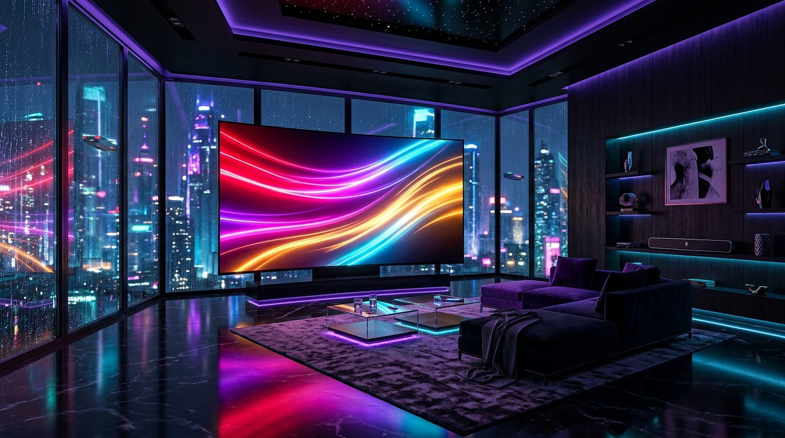
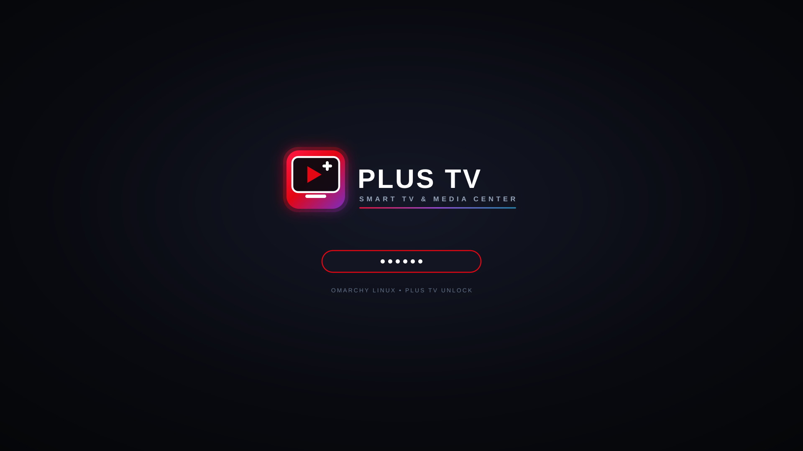

# Plus TV & Omarchy Smart TV Kit 📺 🎮

An all-in-one Smart TV transformation kit for **Arch Linux** and **Omarchy (Hyprland Wayland compositor)**. It turns your PC / HTPC into a modern TV entertainment and cloud gaming hub with an integrated smartphone web remote control.

> 🇹🇷 Türkçe dokümantasyon için: **[BENIOKU.md](BENIOKU.md)**





---

## 🌟 Key Features

### 1. 📱 Smartphone Web Remote Control (No App Install Required)
- **Instant Pairing via QR Code:** Press `R` inside Plus TV or click the top-bar `📱 Remote` button. Scan the on-screen QR code from any smartphone on your local Wi-Fi.
- **Auto-Landscape Controller:** Both the Gamepad and Windows PC Keyboard automatically open in an ultra-wide landscape mode.
- **Responsive Dynamic Scaling:** Designed with dynamic viewport units (`100dvh`) and flexible button sizes (`clamp()`), ensuring that every key (Space bar, arrow keys, function keys, triggers) fits on any phone screen without overflowing or scrolling.
- **Haptic & Visual Feedback:** Vivid neon button glow and device vibration on every key press, showing the active key or combination on an on-screen HUD.
- **Remote Power Management:** Suspend, reboot, shutdown, or lock the system directly from your couch.

### 2. 🎮 Couch Gamepad Controller
- **Dual Control Modes:**
  - `🕹️ WASD (PC Mode)`: For FPS and desktop games (WASD movement, Space to jump, Shift to sprint, Ctrl to crouch).
  - `🏹 Arrow Keys (Retro Mode)`: For TV navigation, emulators, and retro gaming.
- **Continuous Hold-to-Move:** Smooth directional hold support for real-time running and turning.
- **Console ABXY Layout:** Color-coded action buttons with neon visual glow.
- **Shoulders & Triggers:** LT (Aim / Right Click), RT (Fire / Left Click), LB, RB, and quick weapon/slot keys (1-4).

### 3. ⌨️ Full-Featured Windows PC Keyboard
- **Turkish Q & International Layout:** Includes full alphabet, numbers, symbols, Caps Lock, Shift, Tab, Enter, Backspace.
- **Function Keys Row:** Esc, F1–F12, Del.
- **Essential Windows & Linux Shortcuts:** Single-tap chips for `⊞ Win`, `Win+D` (Show Desktop), `Alt+Tab` (Switch Window), `Alt+F4` (Close), `Ctrl+C`, `Ctrl+V`, `Ctrl+Z`, `Ctrl+A`.
- **Air Touchpad & Mouse:** Smooth touch surface with left click, right click, middle click, and scrolling.

### 4. 🖥️ Workspace 1 Isolation & 40px TV Mouse Cursor
- **Dedicated TV Workspace:** Plus TV lives permanently on Hyprland Workspace 1.
- **Application Windows Safe-Separation:** Normal desktop apps and windows open on Desktops 1–9 (Workspaces 2–10). Plus TV cannot be accidentally covered or moved.
- **High-Visibility TV Cursor:** System-wide cursor size enlarged to **40px** (`HYPRCURSOR_SIZE=40`, `XCURSOR_SIZE=40`, and GNOME desktop interface cursor-size), making it effortless to see from across the living room.

### 5. 🎬 12 Media Platform Integrations
- Pre-configured shortcuts with high-resolution vector icons:
  - **beIN CONNECT / Digiturk**
  - **Netflix**
  - **Amazon Prime Video**
  - **Apple TV+**
  - **Apple Music**
  - **YouTube & YouTube Music**
  - **Spotify**
  - **TV+**
  - **Google Chrome**
  - **NVIDIA GeForce NOW**

---

## 🚀 One-Command Automated Installation

### Option A: From Clone / Downloaded Kit

```bash
git clone https://github.com/enisozen/plustv-omarchy-kit.git
cd plustv-omarchy-kit
./install.sh
```

*(Or use `./kur.sh` for the Turkish interface version).*

### What `install.sh` Does Automatically:
1. Verifies and installs system dependencies (`qt6-base`, `qt6-declarative`, `qt6-svg`, `qt6-wayland`, `qrencode`, `wtype`, `jq`).
2. Takes an automatic backup of your existing `~/.config/hypr` and `~/.config/omarchy`.
3. Copies and compiles the Qt6 Plus TV backend (`bin/build`), with an automatic fallback to the bundled binary if build tools are not present.
4. Applies Hyprland TV autostart guardians and bindings.
5. Dynamically adapts all file paths to the current user's `$HOME` directory.
6. Installs media shortcuts, application icons, and browser hardware acceleration flags.
7. Sets the Omarchy `plus-tv` glassy theme and applies the 40px TV cursor.
8. Reloads Hyprland and launches Plus TV seamlessly.

---

## 🛠️ Tech Stack & Architecture

- **Backend & Remote Server:** C++17, Qt6 (Quick Controls 2, Network, DBus, SVG).
- **Desktop Compositor:** Hyprland (Wayland) on Omarchy Linux.
- **Input Simulation:** `wtype` and `hyprctl dispatch send_shortcut` for low-latency Wayland keystroke injection.
- **Web Remote Client:** Zero-dependency vanilla HTML5/CSS3/JavaScript with dynamic viewport calculation (`100dvh`), Web Vibration API, and CSS transform landscape engine.

---

## 🛡️ Disaster Recovery & Btrfs Snapshots

Before performing system updates or testing new desktop software:
```bash
# Create an instant system snapshot
omarchy snapshot create

# Restore if anything goes wrong
omarchy snapshot restore
```

---

## 📄 License

This project is licensed under the [MIT License](LICENSE).
